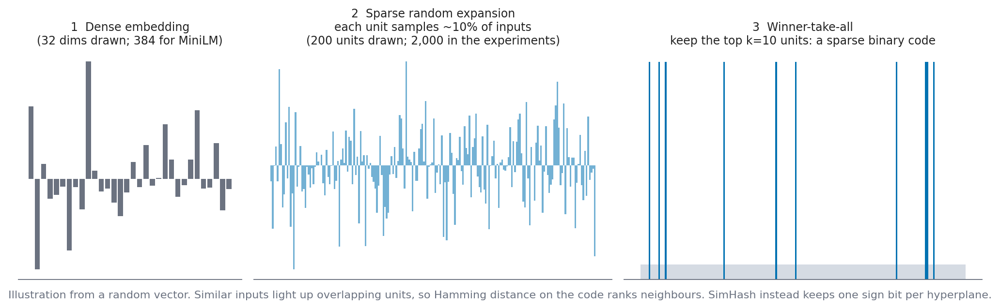
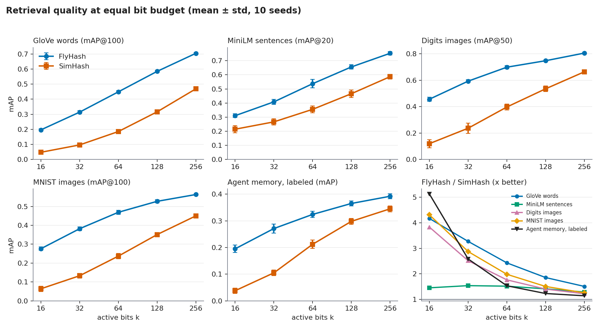
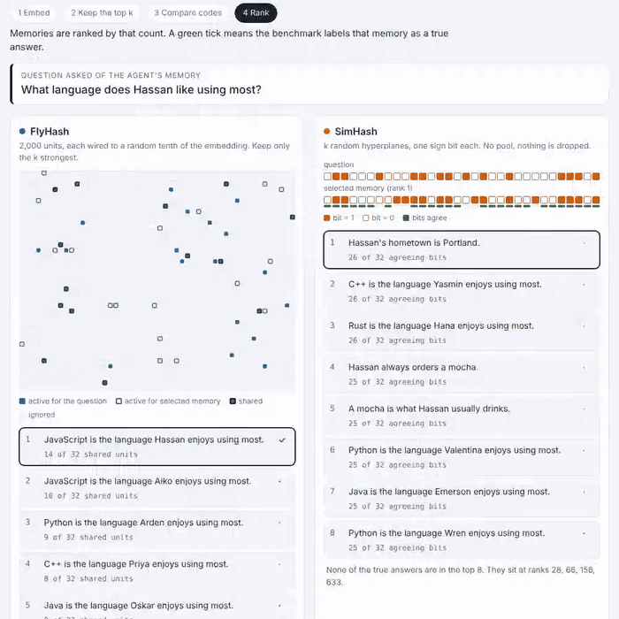
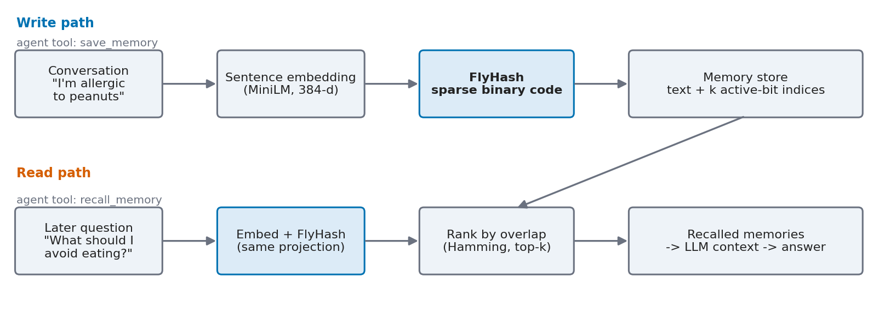

# FlyHash for LLM Agent Memory

[](https://doi.org/10.5281/zenodo.23903302)
[](https://arxiv.org/abs/2611.05791)
[](LICENSE)

[](REPRODUCING.md)

Code, data and demo for the paper **"FlyHash for LLM Agent Memory: An Empirical Validation and a New Application"**
by [Mohan Bheemadolu](https://github.com/mohanji) and [Chrisogonas O. Odhiambo](https://github.com/chrisogonas) ([arXiv:2611.05791](https://arxiv.org/abs/2611.05791)).

FlyHash is a similarity-preserving hash modeled on the fruit fly's olfactory circuit (Dasgupta, Stevens & Navlakha,
*Science* 2017). This repo re-implements it from scratch, validates it against SimHash under a fair, matched-bit
protocol, and applies it to retrieval of long-term memories for LLM agents.



## Key findings

- **Better retrieval at the same bit budget.** FlyHash beats SimHash at every budget (k = 16 to 256) on five
  datasets: GloVe words, MiniLM sentences, Digits and MNIST images, and a labeled agent-memory benchmark. Every gap
  clears twice the combined standard deviation over 10 seeds.
- **The advantage is largest where codes are shortest.** At k = 16 FlyHash is about 4 to 5x better on four of the five datasets (1.4x on MiniLM); at k = 256 it is
  1.1 to 1.5x better.
- **Not a free lunch.** Compared densely, FlyHash's code is larger and slower than SimHash's. A sparse-set
  comparison recovers most of the speed gap but not the memory gap, and at 5,000 records HNSW beats both hashes on
  quality and latency. FlyHash is a quality-per-bit result, not a speed or memory win. See the paper's Limitations.
- **A fair comparison matters.** An early version of this project "found" that FlyHash loses. The cause was a flawed
  comparison (equal total hash length instead of equal *active* bits), not the algorithm. The corrected protocol is
  described in the paper and in the [experiment log](docs/EXPERIMENT_LOG.md).



## Try it: watch one query get ranked

[](https://mohanji.github.io/flyhash-agent-memory/demo.html)

Pick a question and a bit budget k, and the demo walks through how each method encodes the question, keeps its k
strongest units (FlyHash) or k sign bits (SimHash), and ranks stored memories. The rankings are real, computed from the
released benchmark, and the questions are a fixed random sample, so FlyHash loses some of them and the page shows that.

- **Online:** [open the interactive demo](https://mohanji.github.io/flyhash-agent-memory/demo.html)
- **Hugging Face Space:** [FlyHash vs SimHash retrieval demo](https://huggingface.co/spaces/pranamhan/flyhash-agent-memory-demo)
- **Offline:** open `docs/demo.html` in any browser, no install needed.
- **Regenerate:** `python scripts/make_demo_data.py && python scripts/build_demo.py`

## Quick start

```bash
git clone https://github.com/mohanji/flyhash-agent-memory.git
cd flyhash-agent-memory
pip install -r requirements.txt
./reproduce.sh quick        # tests + labeled benchmark + offline demo, about a minute
```

On Windows without bash, run the same steps by hand:

```bash
python -m pytest -q tests
cd src
python agent_memory_realistic_benchmark.py --seeds 2
python offline_demo.py
```

Mapping from each paper table to a command: **[REPRODUCING.md](REPRODUCING.md)**.

## Use FlyHash in your own code

```python
import numpy as np
from flyhash import FlyHash

x = np.random.randn(1000, 384).astype("float32")      # any dense embeddings
fh = FlyHash(input_dim=384, hash_dim=2000, wta_percent=0.05)   # k = 100 active bits
codes = fh.hash(x)                                    # (1000, 2000) sparse binary codes
```

(Run from `src/`, or add it to `PYTHONPATH`.)

## Agent memory demo



`AgentMemory` (`src/agent_memory.py`) wraps the store behind a text-in, text-out interface: `remember(text)` and
`recall(query, k)`. The demo agent gives Claude two tools, `save_memory` and `recall_memory`.

| Demo | Command | Needs |
|---|---|---|
| Offline, over the released dataset | `python src/offline_demo.py` | nothing extra |
| MiniLM-backed memory | `python src/agent_memory.py` | `sentence-transformers` (downloads a model once) |
| Interactive Claude agent | `python src/agent_demo.py` | `anthropic` and `ANTHROPIC_API_KEY` |

Install the extras with `pip install -r requirements-optional.txt`. To try the interactive agent, tell it
"My favorite language is Python and I'm allergic to peanuts", then ask "What should I avoid eating?" a few turns later.

## Dataset

`datasets/agent_memory_v1/` is a labeled agent-memory retrieval benchmark: 6,000 memories (150 named personas x 10
facts x 3-4 paraphrases), 150 questions, and ground-truth relevant memories for each question (about 4 per question).
It is synthetic and deterministic, with no personal data. Format and regeneration: [REPRODUCING.md](REPRODUCING.md).
Also on Hugging Face: [pranamhan/agent-memory-v1](https://huggingface.co/datasets/pranamhan/agent-memory-v1).

```json
{"id": 12, "text": "Which language does Omar prefer to code in?", "relevant_memory_ids": [504, 505, 506, 507]}
```

The other datasets (GloVe, MiniLM sentences, scikit-learn Digits, MNIST) are public and loaded by the scripts.

## Repository layout

```
src/
  flyhash.py                     FlyHash and SimHash implementations
  memory_store.py                FlyHash-backed and FAISS memory stores
  agent_memory.py, agent_demo.py, offline_demo.py     agent memory and demos
  agent_memory_dataset.py        generator for the labeled benchmark
  export_dataset.py              writes the benchmark to datasets/*.jsonl
  agent_memory_realistic_benchmark.py                 labeled-benchmark experiment
  multi_seed_benchmark.py, paired_statistics.py       main results and statistics
  grid_search.py, weight_sensitivity_benchmark.py     ablations
  latency_memory_benchmark.py, sparse_flyhash_benchmark.py,
  hnsw_systems_benchmark.py, end_to_end_latency.py    systems experiments
  *_embeddings.py, real_text_proxy.py                 dataset loaders
datasets/agent_memory_v1/        released benchmark (JSONL)
tests/                           pytest checks
scripts/make_figures.py          regenerates docs/images/
scripts/make_demo_data.py, build_demo.py   regenerate docs/demo.html
docs/demo.html                   interactive ranking demo (open in a browser)
docs/EXPERIMENT_LOG.md           full chronological experiment record
docs/RESEARCH_JOURNAL.md         development notes (setup and troubleshooting diary)
```

## Limitations and open directions

- The labeled benchmark uses offline TF-IDF+SVD embeddings, not a sentence-transformer, and its text is
  template-generated. Results on real conversation logs are future work.
- No genuinely sublinear FlyHash index exists here yet (multi-probe or banded LSH is the natural next step). Every
  comparison is brute force over all records.
- Compression alternatives (product quantization, RaBitQ) and sparse lexical retrieval (BM25, SPLADE) are discussed
  in the paper but not benchmarked.
- A downstream test of answer quality in a full RAG pipeline is not yet done.

## Citation

If you use this code, dataset or demo, please cite the paper:

```bibtex
@misc{bheemadolu2026flyhash,
  title         = {FlyHash for LLM Agent Memory: An Empirical Validation and a New Application},
  author        = {Bheemadolu, Mohan and Odhiambo, Chrisogonas O.},
  year          = {2026},
  eprint        = {2611.05791},
  archivePrefix = {arXiv},
  primaryClass  = {cs.AI},
  doi           = {10.48550/arXiv.2611.05791},
  url           = {https://arxiv.org/abs/2611.05791}
}
```

The code and data release is archived on Zenodo: [10.5281/zenodo.23903302](https://doi.org/10.5281/zenodo.23903302).
See also [CITATION.cff](CITATION.cff). Licensed under the [MIT License](LICENSE).
